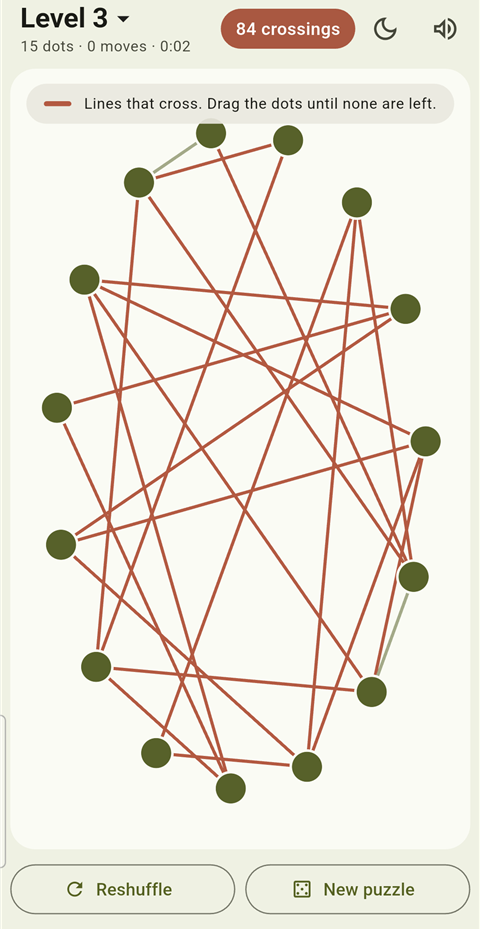

# Untangle

A calm puzzle game for Android, iOS and web, built with Flutter.

Dots are joined by lines, and the lines are tangled. Drag the dots until no two lines
cross. Crossing lines are shown in terracotta; when the last crossing is gone, the board
turns green.



## Features

- 11 levels, from 6 dots up to 91. Beat a level to unlock the next.
- Every puzzle is generated fresh and is always solvable.
- Multi-touch: drag several dots at once.
- Reshuffle the same puzzle, or start a new one.
- Olive light and dark themes.
- Soft sounds with a mute toggle.
- No timers to beat, no ads, works offline.

## How puzzles are made

Draw a few random straight lines. Every point where two lines meet becomes a dot, and
neighbouring dots along each line are joined. That drawing has no crossings, so every
puzzle has a solution. The dots are then placed on a circle in random order.

## Build and run

```sh
flutter pub get
flutter run                          # on a connected phone
flutter build apk --release          # Android APK in build/app/outputs/flutter-apk/
flutter analyze && flutter test
```

Generated assets (only needed if you change them):

```sh
dart run tool/gen_sounds.dart        # assets/sounds/*.wav
flutter test tool/gen_icon_test.dart # assets/icon/*.png
dart run flutter_launcher_icons
dart run flutter_native_splash:create
```

## Project notes

[CLAUDE.md](CLAUDE.md) (code map and design rules) and [docs/ROADMAP.md](docs/ROADMAP.md)
(status and plans).

## License

[MIT](LICENSE)
